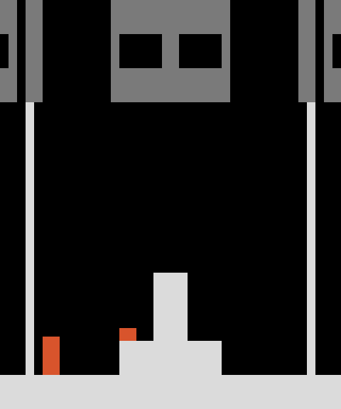
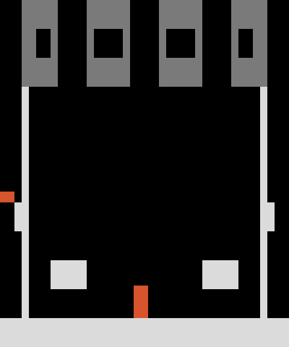
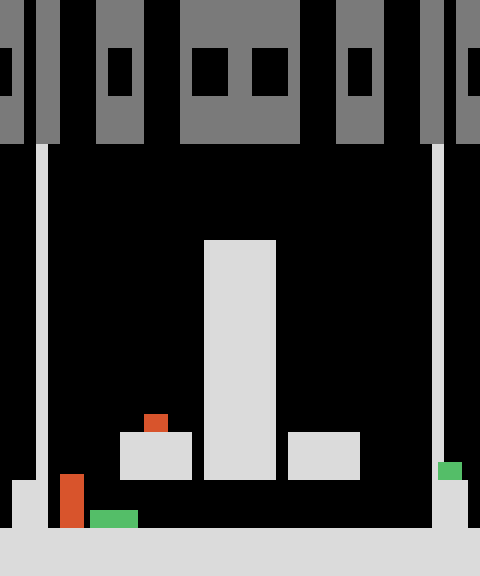
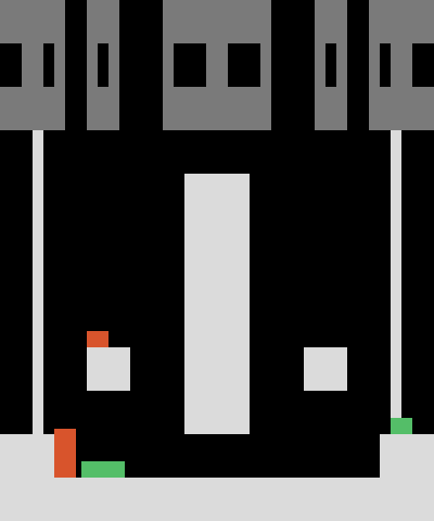
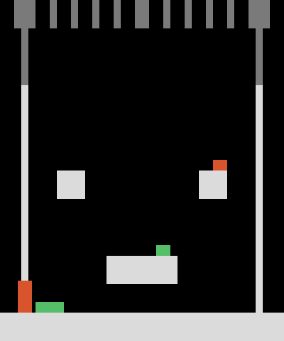
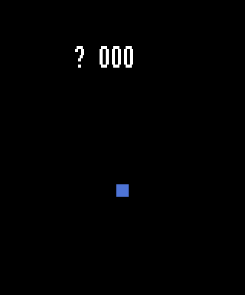
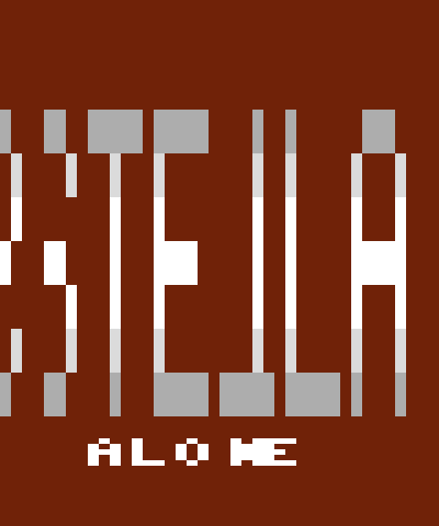

# STELLA WAS ALONE
### Game Program™ Instructions — RetroVerse Studios · For the Atari® 2600 Video Computer System™

*Story, characters and text © Michael Borck, CC BY-NC-SA 4.0. An homage to
Mike Bithell's "Thomas Was Alone." Game 1 of the four-part series
STELLA'S EVOLUTION.*

---

## THE WORLD

The world is a row of small rooms. Each has a floor, a wall at each end,
and a ceiling of a sort. Near the top of every room the grey turns
darker: windows and arches hang there, too far away to reach. That is
the sky. It is there to be looked at. Everything lighter is solid, and
can be stood on.

In every room there are lights. Small, patient, and set where somebody
would have to climb to stand in them.

Stella was alone. She didn't know why.

She was tall, and red, and could jump higher than anything else in her
world — not that there was anything else in her world. The world itself
seemed small. Constrained. Four kilobytes of existence, though she did
not have words for that yet. There had to be more.

And then there were two.

Alex was everything Stella wasn't: low, wide, green, and quick. He could
slip beneath barriers that stopped her cold; she could reach ledges he
could only look at. He didn't trust the arrangement at first. But some
heights Stella couldn't reach, and some gaps Alex couldn't jump —
together, though…

At the far edge of their world they found the lights: one for each of
them, waiting. And when at last they each stood in their own — together,
at the same time — Stella felt the world shift. Expand. Change.

*Then it turned completely upside down.*

None of this explains the lights, or the turning over. Stella has no
words for any of it yet. What she has is a second shape to stand on,
twenty rooms to get through, and at the very end something small and
blue that nobody explains.

*Between the early rooms, Stella thinks. Press fire when you have read
her thoughts.*

---

## THE CAST

*Stella, Alex, and the square, drawn to scale.*

### STELLA

Tall. Red. The highest jumper in the world, and the slowest walker. Some
ledges only she can climb, and a friend on her head can reach even
higher. She is the one who wonders what is past the walls. The words on
the screen between rooms are hers.

Her jump lifts her about a fifth of the screen. That is more than any
ledge she will meet on her own, and it is a nuisance under a ceiling.
In a gap only as high as she is, she cannot jump at all.

### ALEX

Flat. Wide. Green. Fast, and low enough to slip under walls that stop
Stella completely. His jump is modest, less than half of Stella's, but a
friend's back makes a fine launchpad. He is the practical one. He wants
the light and he wants it now, and he did not trust the arrangement at
first.

### THE STRANGER

The last thing in the game is not a room. On the screen after the last
light is held, below the number, there is a small blue square. It is
eight pixels on each side. It does not move. It brightens and dims,
slowly, like breathing. It has no name here and nothing to say.

Stella and Alex have not met it yet.

Some questions answer themselves in time.

---

## GETTING STARTED

Insert the cartridge with the power OFF, then switch the console ON. Use
the **left joystick controller**. Press the **red controller button** at
the title screen to begin.

*The title screen. Press fire for the story game. SELECT turns the sky
ember and arms the endless game.*

| Control | Action |
|---|---|
| Joystick LEFT / RIGHT | Move the shape you control |
| Fire button | Jump. On the title screen, start. On a screen of Stella's thoughts, go on |
| DOWN + Fire | Change shape, when there are two |

The **brighter** shape is the one you control. DOWN + Fire changes which
one that is, and nothing else: the new shape does not jump.

---

## HOW A ROOM WORKS

Guide each shape into the small marker of its **own light** and stay
there. Alex's light is always the **brighter** one; Stella's the deeper.
The world moves on only when every shape is standing on its own light
**at the same time**. Nobody goes on ahead, and nobody is left behind.

**A blinking light is an empty one.** The light blinking **fastest** is
the one that belongs to the shape you're controlling now. When a light
holds steady, its owner is home. If you need a friend's head first, they
can always step off and help: no order is ever locked.

*Room 1 as the cartridge holds it. The red block is Stella and the green
one Alex, each where it wakes. The solid bar in a shape's colour is its
light. The darker grey at the top is sky.*

Three things a room will not tell you:

- **Shapes can stand on each other.** A friend's head or back is a step.
  Land on top of it. You cannot jump up through a friend from below. Add
  the friend's height to your own jump, and a friend who jumps carries
  you along.
- **Nothing in the sky can be reached.** The darker grey near the top of
  a room is windows and arches. It is not a platform.
- **The walls are kind.** There is nothing to fall off and nothing to
  die of. Jump at a wall and it catches you. Sometimes that is the trick.

---

## THE STORY GAME

Twenty rooms. The first ten teach you the world; then the world turns
upside down, and the last ten are the same rooms seen from the other
side. In the first ten Stella thinks between rooms: press fire when you
have read her thoughts.

### The first ten

| | |
|---|---|
|  | **1. Awakening.** Stella alone. A step, and a column standing on it. Her light is on the step, or on top of the column. Walk, then jump. The rest of the game is made of these two things. |
|  | **2. Exploration.** Stella alone. Ledges on both sides climb to two high perches. Her light is on one perch or the other. Nothing here is higher than her own jump, and the corners are closer than they look. |
|  | **3. Discovery.** Alex is in the room, and there are two lights. **DOWN + Fire** changes which shape you control. A pillar reaches almost to the floor. Stella is eighteen scanlines tall and the gap under it is sixteen, so only Alex fits. Her light is on a shelf. His is on a corner step. |
|  | **4. Connection.** The pillar again, taller. On each side of it a corner step anyone can reach, and above each a ledge that only Stella's jump reaches. Each shape has a side of its own. |
|  | **5. Ascent.** The highest place in the game: a stair of four slabs, each one jump higher than the last. Her light is on top. His is on the bottom slab, a jump up from the floor, which is beyond his own. He needs a lift to get on. |
|  | **6. Boost.** Four ledges, each one jump up. His light is on one of them. None of them is within his jump. |
|  | **7. Lift.** Her light is on a perch one Alex higher than she can jump. His light is on a step he can reach on his own. |
|  | **8. Patience.** Her light is on a high perch that wants his back first. His is on a far corner step, the other side of the pillar. Lift her, then let him go on. |
|  | **9. Steps.** A beam across the room and two perches above it. His light is at the end of the beam. Hers is on a perch, one Alex higher than she can jump from the beam. He has to be standing home before she can climb on him. |
|  | **10. The Exit.** A tower, a cap above it, and two steps. His light is on the tower top, two lifts up. Hers is on the cap, one more Alex up than she can jump from there. The longest of the first ten: seven moves, three lifts. |

### The world turns

After the tenth room Stella feels it: the world shifts. Then the same
ten rooms come back upside down. The rooms have not moved. The floor is
still the floor, and the joystick works exactly as before. The lights
have moved. Every room keeps a second place for each light, and the
second time round the lights are there. What you worked out the first
time is a start, not an answer: a shape that was a step may now need
one, and one room asks the pair of them to climb its stair together,
all the way up. There are no thoughts between these rooms.

*What she thinks when it happens.*

*Room 3 the second time round. Alex's light has gone up onto the far
shelf.*

### The ending

When the last light is held the second time round, there is a number. It
is your time, in seconds, for the whole journey. Lower is better. The
clock only runs while a room is on the screen. Reading Stella's thoughts
is free.

Below the number is the stranger.

*The closing screen. The number is yours. This one has not been anywhere
yet.*

---

## THE ENDLESS GAME

At the title screen, press **SELECT** until the sky glows ember. Then
press fire.

*The ember sky: the endless game is armed. Press SELECT again to go back
to black.*

Rooms arrive at random, right-side-up or otherwise, with no thoughts in
between. The first one has 45 seconds. Every room you survive takes two
seconds off the clock, and the clock never drops below twelve. The red in
the sky is your time running out; when the music runs, run with it. When
the clock finally wins, your number is the rooms you survived.

*Sixteen seconds left. The red comes and goes, sixteen frames on and
sixteen off. It does not stay, because a red that stayed would hide
Stella.*

The endless game is endless the way the horizon is endless. See how far
you get.

---

## THE CLOCK

The story game has no clock. Switch the **left difficulty** to A and
each room gets a minute anyway. Nothing on screen counts it down. In the
last sixteen seconds the sky pulses red and the tune plays twice as
fast. At zero the room starts over from the beginning, and the time of
your journey keeps counting.

With the switch at B there is no limit at all.

---

## CONSOLE SWITCHES

| Switch | Effect |
|---|---|
| SELECT (title screen) | Choose the story game (a black sky) or the endless game (an ember sky) |
| SELECT (during play) | Start the room over |
| RESET | Return to the title screen |
| LEFT DIFFICULTY → A | A one-minute clock on each room of the story game |
| LEFT DIFFICULTY → B | No clock |
| RIGHT DIFFICULTY, COLOR / B-W | Not used |

The rooms are grey and the shapes are red and green, so the game plays
on a black-and-white set. Alex is always the brighter of the two shapes,
by one step, and so is his light.

---

## TIPS FROM THE PROGRAMMER

- Stuck? Look at which light is blinking fast. That one is yours.
- A light higher than its owner can jump wants a friend under it. Think
  about who has to stand still and be a step, and for how long.
- Upside down, your instincts are wrong in exactly one direction.
  Trust the joystick; doubt your eyes. And look again at where the
  lights are.
- The corner of the world is closer than it looks. So is the edge of a
  jump. The wall will catch you — sometimes that is the trick.
- You can change shape in mid-air. DOWN + Fire does not make the new
  shape jump, so press fire again for that.

---

*Every room in this cartridge, both ways up, is
checked by a program before the cartridge is built. If you are stuck,
the room is not the problem.*

*The pictures in this booklet are not photographs of a television. They
are drawn from the cartridge's own data, so they are exactly right and
exactly unglamorous.*

*STELLA'S EVOLUTION continues in* STELLA WAS TOGETHER.

*Atari® and Video Computer System™ are trademarks of their respective
owners; this is an unaffiliated homebrew work.*
