# STELLA WAS TOGETHER
### Game Program™ Instructions · RetroVerse Studios · For the Atari® 2600 Video Computer System™

*Story, characters and text © Michael Borck, CC BY-NC-SA 4.0. An homage to
Mike Bithell's "Thomas Was Alone." Game 2 of the four-part series
STELLA'S EVOLUTION. It follows* STELLA WAS ALONE.

---

## THE WORLD

The world had changed. Expanded. Stella could feel it.

There were no more rows of small rooms. There was a tower, one floor
standing on another, and a sky over it that went on further than she
could jump. The grey was still grey. The lights were gone, and in their
place were ledges, each one lit in somebody's colour, each one somebody's
home.

Alex was still there. Low, wide, green, quick, and still not sure about
any of it.

And the small blue square from the end of the last world was there too.
In the dark, before anything else had arrived, it opened its eyes.

Its name was Marcus. He was square, and he sat between them in every
way: not as tall as Stella, not as wide as Alex, a jump that was neither
the highest nor the lowest. He fitted places neither of them could.
Alex didn't trust him. Too perfect, he thought. Too... square.

The tower did not care what Alex thought. Its floors were built for
three. Some of its ledges only Stella could climb to, some only Alex
could slip onto, and some only Marcus fitted. Most of them nobody could
reach alone at all.

Not every climb is made alone. Sometimes standing on someone else is the
only way up.

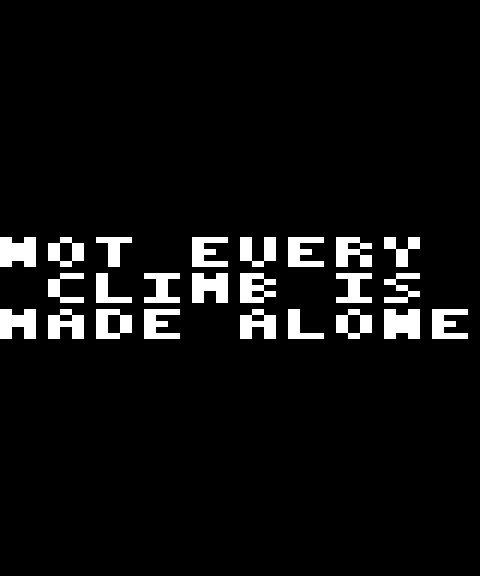

*Between floors, Stella thinks. Press fire when you have read her
thoughts.*

---

## THE CAST

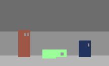

*Stella, Alex and Marcus, drawn to scale.*

### STELLA

Tall. Red. The highest jumper in the tower and the slowest walker. A
friend standing on her head reaches higher than anyone. She is the one
who wonders what is past the walls, and the words between floors are
hers.

Her jump lifts her a little over twice her own height. Under a low
ceiling that is no help at all.

### ALEX

Flat. Wide. Green. The fastest of the three and the lowest jumper by a
long way: his jump is less than half of Stella's. A friend's head turns
that into something. He is the practical one, and the last to
trust anybody new.

### MARCUS

A square. Blue. The newcomer. He walks faster than Stella and slower than
Alex, and jumps higher than Alex and lower than Stella. He is shorter
than Stella, so he fits under things she can't. He is narrower than
Alex, so he fits into gaps Alex can't. Game 1 ended on him, breathing
quietly under a number. This game opens on him.

---

## GETTING STARTED

Insert the cartridge with the power OFF, then switch the console ON. Use
the **left joystick controller**, or both joysticks for two players.
Press the **red controller button** at the title screen to begin.

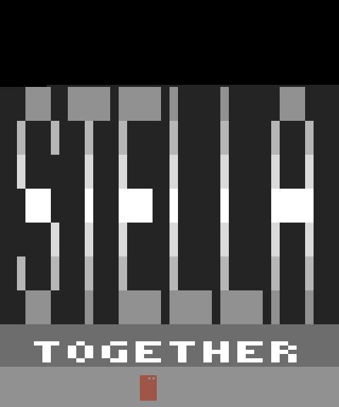

*The title screen. Press fire to begin.*

| Control | Action |
|---|---|
| Joystick LEFT / RIGHT | Walk |
| Fire button | Jump. On the title, start. On a screen of Stella's thoughts, go on |
| DOWN + Fire | Change who you control: Stella, then Alex, then Marcus, then Stella again |
| UP | Go through a door, or change the world (see THE TOWER'S TRICKS) |

The character you control is the one that never flickers. The other two
take turns on the screen, a frame each, so they shimmer a little. That is
the cartridge sharing out its sprites, and nothing is wrong.

The joystick steers in the air. A jump that is going to miss can often be
pulled back.

---

## HOW A FLOOR WORKS

Every character has a **home**: a ledge lit in their own colour. The
floor is finished when all three are standing on their own homes **at
the same time**. Nobody goes on ahead and nobody is left behind.

**A blinking home is an empty one.** The home of the character you
control blinks fast. The other empty homes blink slowly. When its owner
stands on it, a home holds steady and sounds that character's note.
When the third one arrives, the three notes play together and the floor
is done.

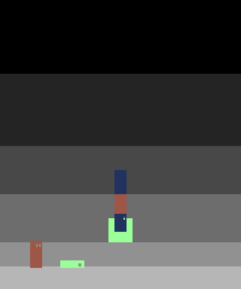

*Floor 1, Together Again. The lit bars are homes: green for Alex at the
bottom, red for Stella in the middle, blue for Marcus at the top.*

Four things a floor will not tell you:

- **Heads are steps.** Anyone can stand on anyone. Land on a friend from
  above; you pass through them from below or from the side. A friend
  does not carry you when they walk, so step off before they go.
- **The edges join.** Walk off the left of the screen and you come in on
  the right. A ledge cut by the edge of the screen is one ledge.
- **Nothing kills you.** There is nothing to fall into and nothing to
  die of. A bad jump costs you a walk back.
- **The sky is never solid.** Everything you can stand on is lighter than
  the sky behind it.

---

## THE TOWER'S TRICKS

The tower teaches you three things, one act at a time, and never takes
one away once you have it.

### The edges (Act 1)

The screen wraps round. In the first act the way to a home is sometimes
off the side of the screen and back in on the other.

### Doors (Act 2)

A **door** is a thin column that blinks on and off. Stand in it and push
**UP**, and you come out at the door's other end, standing still. Only
the character you control goes through. Doors work in the air as well as
on the ground. A door does not always go up: some go across, and some
come back down.

### Two truths (Act 3)

At the very edges of the screen, from the third act on, there are two
thin beams that blink: **rifts**. Stand in one, on the ground or on a
friend's head, and push **UP**, and the world changes. The tower has two
truths, and a rift swaps one for the other.

You don't move. The world does. Some ledges are true in both worlds and
some in only one. When a ledge stops being true, whoever was standing on
it falls. It happens to everyone at once, wherever they are, so look
before you swap.

You can always tell which world you are in from the sky. In one world it
is dark above and light near the ground. In the other it runs the other
way.

### Act 4

The last two floors use everything at once.

---

## THE STORY GAME

Eleven floors in four acts. Between floors Stella thinks; press fire to
go on.

It starts in the dark. Marcus is there first, alone. The sky arrives a
band at a time, then he opens his eyes, and then the others come. Press
fire if you want to skip it.

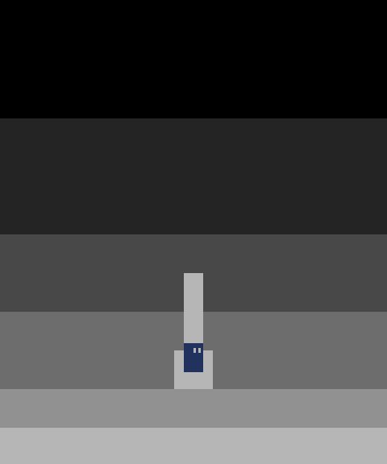

| | |
|---|---|
|  | **1. Together Again.** A totem of three steps. Marcus wakes on the lowest. Alex's home is the bottom step, drawn wide like him; Stella's is the middle; Marcus's is the top. |
| 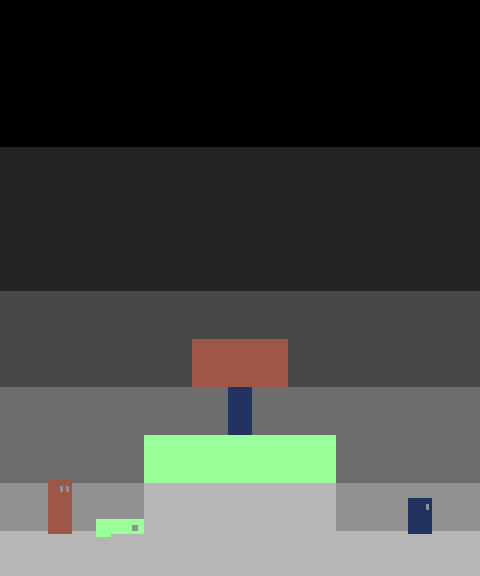 | **2. The Low Door.** A wide block with a slab on top and a low gap between them. Stella's home is the slab, Alex's the block, and Marcus's is a little ledge inside the gap. |
| 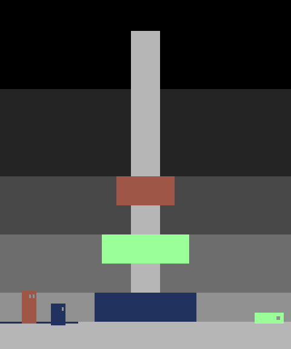 | **3. The Wall.** A wall from the sky to the floor down the middle of the screen, and stairs on both sides of it. Alex wakes alone on one side. |
| 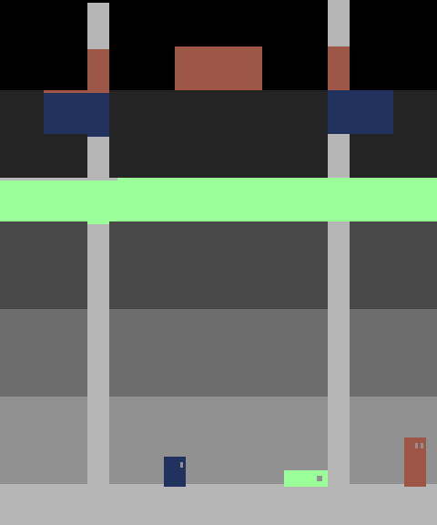 | **4. The Fold.** A shelf across the whole screen, too high for anyone. Two doors. Every home is on the shelf or above it. |
| 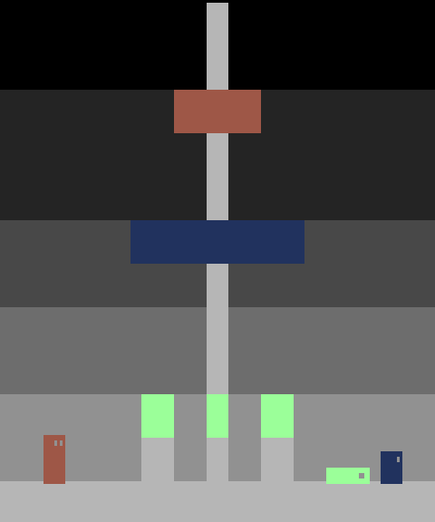 | **5. The High Door.** One door, standing in a slot between two walls. |
| 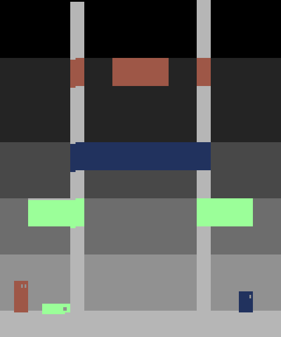 | **6. The Cross.** Two doors again. Doors don't have to go up. |
| 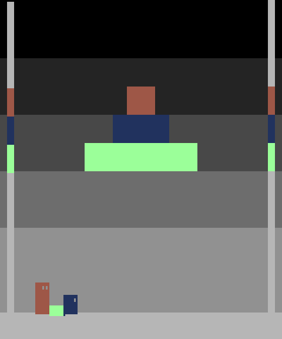 | **7. Two Truths.** The homes are in plain sight from the start, on a totem on a shelf, and nothing in this world reaches them. The rifts arrive. |
| 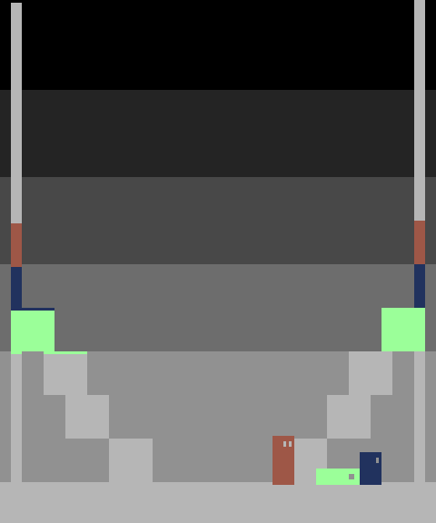 | **8. The Handoff.** Stairs climb to a perch at the edge of the screen, standing in the rift. |
| 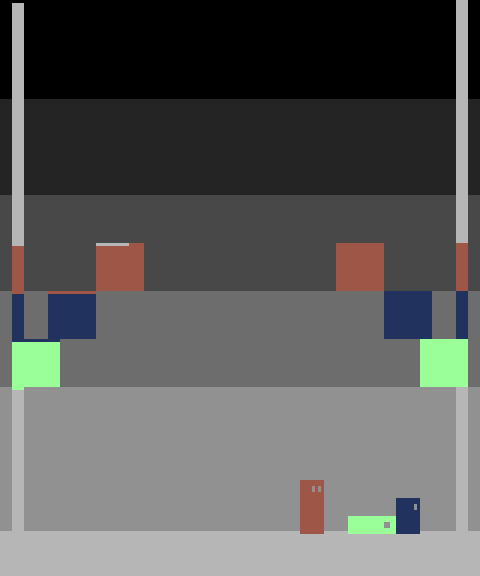 | **9. The Way Home.** The same tower, but something has been exchanged. |
| 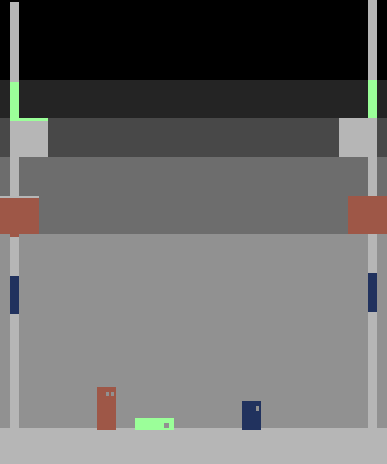 | **10. The Seam.** Everything happens at the edge of the screen, where the two sides meet. The doors stand in only one world. |
| 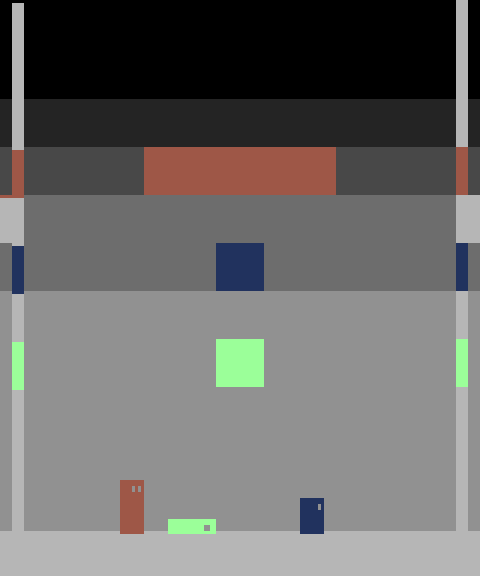 | **11. Where They Meet.** The first floor's totem again, upside down, true in only one world. The hardest floor in the game. |

When the last floor is done there is a number. It is your time, in
seconds, for the whole climb. Lower is better. The clock only runs while
a floor is on the screen; reading Stella's thoughts and watching the
opening are free.

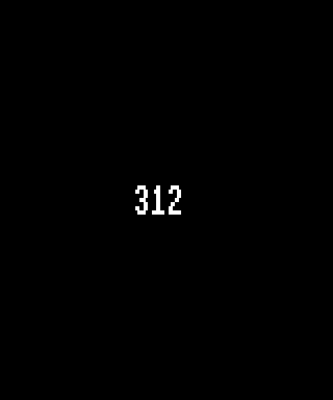

---

## THE SKY

The tower has a sky, and it is never quite the same twice.

When the three of them set out, it is nearly all dark: black overhead, a
little grey at the edge of the world. Stella took it for the end of a
day. She had only ever known the end of things.

It was not dusk. Every time they climb higher together, the grey climbs
too. By the top of the tower the light has nearly filled the sky, and
the dark is a thin strip overhead. It had been the hour before dawn all
along.

Nobody will tell you how high you are. Look up.

---

## THE MUSIC

In the last world Stella had one tune and one voice to play it. It is
still here. Underneath it now there is a second voice, holding up each
phrase.

Each of them has a note. Marcus's is the lowest, then Stella's, then
Alex's. Get somebody home and you hear theirs. Get all three home and you
hear them together.

You can hear who jumped, too.

---

## THE ENDLESS GAME

At the title screen, press **SELECT** until the sky glows ember. Then
press fire.

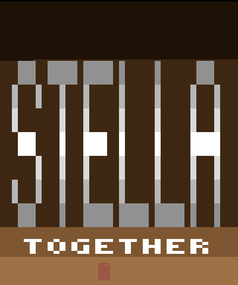

Floors arrive at random from all eleven, never the same one twice
running, with no thoughts in between. The first has 45 seconds. Every
floor you finish takes two seconds off the next, and the clock never
drops below twelve. When the clock wins, the screen shows how many
floors you finished and how long you lasted.

---

## THE CLOCK

The story game has no clock. Switch the **left difficulty** to A and
every floor gets 45 seconds, starting from the next floor. Nothing on
the screen counts down. In the last sixteen seconds the music plays
twice as fast and the sky goes dark, a step at a time. At zero the floor
starts again from the beginning, and the time of your climb keeps
counting.

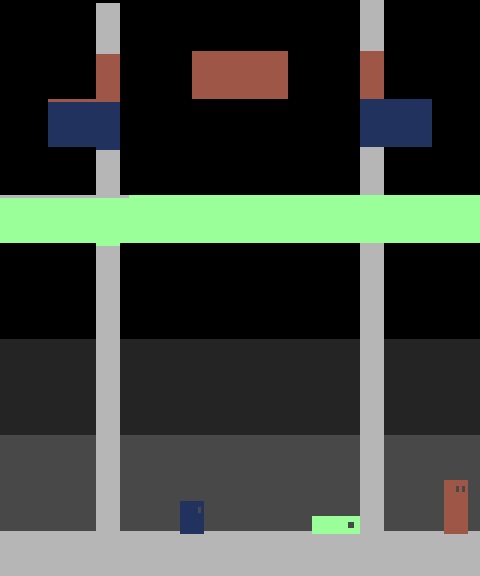

*A few seconds left. The sky goes dark, not red: in this tower, colour
belongs to the three of them.*

With the switch at B there is no limit.

---

## TWO PLAYERS

Press **SELECT** at the title once and Alex appears beside Stella: that
is the two-player game. The second player uses the right joystick.
Player one starts each floor as Stella and player two as Alex.
**DOWN + Fire** takes Marcus, or whoever nobody is holding. Both
players' homes blink fast.

Two players can do something one cannot: two people can move at once.
Nothing in the tower needs it. All of it can be done alone, one
character at a time.

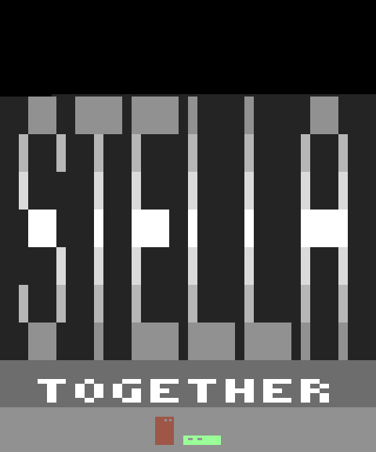

---

## CONSOLE SWITCHES

| Switch | Effect |
|---|---|
| SELECT (title screen) | Steps through four games: one player, two players, endless with one player, endless with two. Stella stands alone for one player and Alex joins her for two; the sky turns ember for endless |
| RESET | Back to the title screen, keeping the game you chose |
| LEFT DIFFICULTY → A | A 45-second clock on each floor of the story game |
| LEFT DIFFICULTY → B | No clock |
| RIGHT DIFFICULTY, COLOR / B-W | Not used |

The tower is grey and only the characters and their homes have colour,
so it plays on a black-and-white set. Alex is always the brightest of
the three, Stella in the middle, Marcus the darkest, and their homes
match.

---

## TIPS FROM THE PROGRAMMER

- Stuck? The fast-blinking home is the one belonging to whoever you are
  controlling. Every answer is at the back, behind a warning.
- A home above its owner's jump wants a friend underneath. Ask who has to
  stand still, and for how long.
- Steer. A jump can be pulled in the air, and a long jump off a friend's
  head goes further than it looks.
- Before you change worlds, look at where everybody is standing. A swap
  takes everyone with it.
- The edge of the screen is not a wall. On the last two floors it is the
  middle of everything.

---

## ABOUT THIS CARTRIDGE

### MADE THE 8K WAY

Game 1 kept to the rules of 1977: 4,096 bytes and nothing else. This
game is the next step the real 2600 took. In 1981 Atari could not fit
its home version of *Asteroids* into 4K, so the cartridge carried 8K in
two halves and switched between them. That trick is called bank
switching, and this cartridge uses the same scheme, F8.

So there is twice the room. It went on the things a game of 1981 would
spend it on: a title screen, a story told between floors, a second
player, a second voice in the music, and a world that joins at the edges
and has two truths. The console is the same one. It still has 128 bytes
of memory, and the options are still the console's own switches, as
they were.

One half of the cartridge plays the game. The other holds the words, the
title, the music and the sky. The game calls on it every frame for the
music, and whenever the sky needs painting.

### FROM THE FIRST GAME

The blue square under the number at the end of *Stella Was Alone* is
Marcus. This game opens on the same square, in the dark, and wakes it.

Stella and Alex are the same size and the same colours as before, down to
the byte. Standing on a friend's head works as it did.
The music is the first game's tune, note for note, with a second voice
under it now. The endless game keeps the first game's ember title and its
clock, 45 seconds falling to twelve.

What changed: a lit pad became a home you stand on, the rooms became a
tower, the edges join, there are doors and two worlds, and the world got
a sky that changes as you climb.

### HOW THIS GAME WAS MADE

The story, the characters and the series are Michael Borck's. The code,
the floor designs, the test tools and much of the writing in this booklet
were developed with the help of generative AI models, working under his
direction. He reviewed, edited and approved all of it, and decided what
went into the game.

Programs written for this project check the game on every build. One
replays the game's own physics to prove that every floor can be finished,
and that each floor's trick can't be skipped. One runs the cartridge in a
software model of the console: it plays the story through, plays the
hardest floors move by move, listens to the music, and checks the timing
of every line the television draws. One draws this booklet's pictures
from the cartridge's own frames. None of them is inside the cartridge.

This page is here because a player should be able to know how a thing
they enjoy was made. The tools did a great deal of the work. The
choices, and the responsibility for them, are his.

### THE SOURCE

The whole game is open: the source, the tools, the design documents, and
a record of every design decision and why it was made, at
[github.com/retroverse-studios/stellas-evolution](https://github.com/retroverse-studios/stellas-evolution).

---

## ⚠ PAST THIS POINT: SPOILERS

Everything after this page gives the game away.

Behind the Design explains what the cartridge does without telling you,
and why. The Walkthrough is every floor's answer.

Play first if you would like to find these things yourself. Read on if
you would rather know. Both are good ways to meet a game, and the second
is not cheating.

<strong>Behind the Design</strong> (open to read)

### Colour means somebody

The tower is grey. The sky is grey, the ledges are grey, the doors and
rifts are grey. The only colours on the screen are the three characters
and their homes. A home is in colour because a home is what someone
wants. When the series' third game needs something to be wrong, it will
break this rule.

The order of brightness never changes either: Alex brightest, Stella in
the middle, Marcus darkest, whoever you are controlling. On a
black-and-white set, or to a player who can't tell red from green, the
three are still three.

### The hour before dawn

Each act has its own sky, a little lighter than the last. The black at
the top never quite goes. In the other world the sky runs backwards, and
the black that was overhead ends up at your feet; if it were any lighter
there, Marcus would vanish against it.

### Every floor is proved before it ships

A program replays the game's physics, steering in the air as you can,
and must find a way home for every character on every floor or the build
fails. It also proves the negatives: that floor 3 can't be done without
the edges, floor 4 without the doors, floor 7 without the second world,
and so on. A floor's trick is never optional.

That program can be too generous. It imagines a friend standing wherever
that friend could ever get to, all at once. For floors 10 and 11 that
isn't good enough, so a second program plays them in the cartridge
itself, a move at a time, and checks that the order in the walkthrough
is real. It also checks that the shortcuts don't work.

### Floor 11 is in order

The world swap is for everyone. On the last floor the totem is true only
in the first world, so once anybody is home another swap would drop
them off it. All the swapping comes first, and after the last swap the
three of them are standing on one small stone. From there Stella can
only get up from Alex's head, so she goes while he is still on the
stone. Alex can make his leap alone. Marcus can only get in from Alex's
head once Alex is home. Stella, Alex, Marcus: one order.

### The edges

The screen has always wrapped round in this game. Act 1 makes you use it.
By Act 4 a ledge, a rift and a door all stand on the seam at once, and
the seam is where the floor is.

### Two halves

The cartridge is two 4K banks. Play runs in one. The other holds the
title, every word Stella thinks, the music, the sky painter and most of
the opening. During play the game switches over to it for the music
once a frame, and for the sky whenever it changes, and straight back.

### Eight kilobytes

All of it fits in 8,192 bytes. There are 71 bytes to spare in the half
that plays the game, and 805 in the other.

<strong>Walkthrough</strong> (printed upside down in the booklet, so you only read it on purpose)

*Heights are the tower's: up is up. "The rift" means the thin beam at
either edge of the screen.*

**1. Together Again.** Stella stands under the totem and jumps onto the
middle step. Marcus hops up the steps to the top. Alex can't
reach the bottom step alone: he jumps onto a friend's head on the floor
and from there onto the step.

**2. The Low Door.** Stella jumps onto the block, then onto the slab.
Alex jumps onto the block from a friend's head. Marcus climbs onto the
block, walks into the gap, and hops up onto the little ledge inside.
Stella is too tall for the gap.

**3. The Wall.** Alex can't reach his stair alone, and his friends are
on the other side of the wall. Walk one of them off the edge of the
screen; they come in on Alex's side. They stand on the bottom stair and
Alex climbs them to his. Stella climbs her stairs one at a time, and
Marcus hops onto the bottom one.

**4. The Fold.** Everyone stands in the left door on the floor and
pushes UP. It lets out on the shelf, which is Alex's home. Marcus jumps
onto the short ledge nearest the door. Stella jumps up to the high ledge
in the middle. The right door comes back down to the floor.

**5. The High Door.** Alex's home is the top of a wall beside the door;
he gets there from a friend's head and never uses the door. Stella and
Marcus jump onto a wall, drop into the slot, and push UP. The door lets
out on the shelf, which is Marcus's home. Stella jumps from the shelf to
her ledge.

**6. The Cross.** The doors cross over. Alex takes the left door, which
puts him straight onto his ledge. Marcus takes the right door onto the
shelf, his home. Stella takes the right door too, and jumps from the
shelf up to her perch.

**7. Two Truths.** Walk into the rift on the floor and push UP. In the
other world there are two rungs on the left. Climb them to the shelf,
and from the shelf the totem: Marcus to the middle step, Stella to the
top. Alex's home is the shelf, but every rung is too high for him: he
climbs a friend at each one.

**8. The Handoff.** Everyone climbs the stairs to the perch at the edge.
When all three are up, one of them stands in the rift and pushes UP.
The stairs are gone in the other world, which is why nobody can be left
on them. The perch is Alex's home. Marcus and Stella climb the new
ledges above it.

**9. The Way Home.** Push UP in the rift on the floor. The stairs are in
the other world this time, and so is the perch, but the homes are not:
when you get there they vanish. Climb to the perch anyway, all three,
and swap back from it. The homes come back around you. Alex is home;
Marcus and Stella climb to theirs.

**10. The Seam.** All three homes are in the second world.
- On the floor, walk into the rift and push UP. In the second world the
  doors are there: stand in one and push UP, for everyone. You come out
  on the seam ledge, the ledge cut in half by the edge of the screen.
- Swap back from the seam ledge. Stand at its far right end, in the rift
  but past the door, or UP takes the door instead.
- In the first world there is a high ledge above the seam ledge. Alex
  climbs onto Stella's head and from there onto it, and Stella jumps up
  after him. Marcus waits on the seam ledge, at its right-hand end.
- Stella walks to the right along the high ledge, nearly to its end.
  Alex climbs onto her head so that he sticks out past her into the
  rift, and pushes UP. Stella drops home onto the seam ledge, and Alex
  lands on his.
- Stella stays at the left end of her home. Marcus climbs onto her head,
  then takes a long jump left, steering all the way, onto the ledge in
  the middle. From the bare seam ledge it can't be done.

**11. Where They Meet.** The totem is true only in the first world.
- Walk into the rift on the floor and push UP. In the second world, each
  of them takes the left door. It lets out on a walkway high on the
  right.
- All three walk right to the very end, into the rift. Push UP. The
  walkway vanishes and everyone lands together on the small stone at the
  edge.
- Now the order matters. Alex stands at the inner end of the stone.
  Stella climbs onto his head and leaps left onto the top of the totem.
- Alex leaps left onto the bottom step, his home, on his own.
- Alex walks to the right end of his step. Marcus leaps from the stone
  onto Alex's head, then hops up to the middle step. Stella's ledge is
  in the way from anywhere else.

---

*Every floor in this cartridge is checked by a program before the
cartridge is built. If you are stuck, the floor is not the problem.*

*The pictures in this booklet are not photographs of a television. They
are frames of the game, drawn from what the cartridge itself sends to
the screen.*

*STELLA'S EVOLUTION continues in* STELLA'S JOURNEY.

*Source: [github.com/retroverse-studios/stellas-evolution](https://github.com/retroverse-studios/stellas-evolution)*

*Atari® and Video Computer System™ are trademarks of their respective
owners; this is an unaffiliated homebrew work.*
